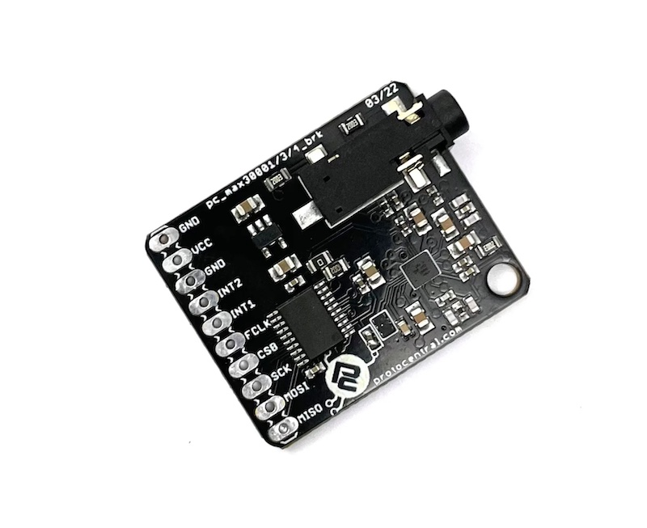

# ProtoCentral MAX30001 ECG and Bio-Impedance Arduino Library

[](https://github.com/Protocentral/protocentral_max30001_arduino_library/actions/workflows/arduino-lint.yml)
[](https://github.com/Protocentral/protocentral_max30001_arduino_library/actions/workflows/compile-examples.yml)

Arduino library for the **ProtoCentral MAX30001 ECG and Bio-Impedance Breakout**: single-lead ECG, bio-impedance (BioZ) respiration and hardware heart-rate detection from the Analog Devices MAX30001 analog front end. Every example runs on an Arduino Uno.

## Don't have one? [Buy it here](https://protocentral.com/product/protocentral-max30001/)



## Links

| | |
|---|---|
| 🛒 Product page | https://protocentral.com/product/protocentral-max30001/ |
| 🔧 Hardware design files | https://github.com/Protocentral/protocentral_max30001 |
| 📈 OpenView companion app | https://github.com/Protocentral/protocentral_openview |
| 📄 MAX30001 datasheet (Analog Devices) | https://www.analog.com/media/en/technical-documentation/data-sheets/max30001.pdf |

## How it works

The MAX30001 has two measurement channels and an on-chip heart-rate detector. Both channels share the RA and LA electrodes; RL holds the body at the chip's common-mode voltage.

| Block | Signal | How |
|---|---|---|
| **ECG** | Single-lead ECG | 18-bit, 128/256/512 SPS, gain 20–160 V/V. Default 80 V/V, 0.5 Hz high-pass, 40 Hz low-pass (28 Hz at 128 SPS). |
| **BioZ** | Respiration | The chip drives a 16 µA, ~8 kHz current through RA/LA and demodulates the voltage. As the chest expands, its impedance changes by a fraction of an ohm. 20-bit, 64 SPS, gain 10 V/V, 0.05 Hz high-pass, 4 Hz low-pass. |
| **R-to-R** | Heart rate | Hardware R-wave detector on the ECG channel. The library reads the R-R interval each time the chip flags a beat. |
| **Lead-off** | Electrode contact | 10 nA DC current on each ECG input; a comparator flags an input that drifts past VMID ± 300 mV. |

Samples queue in on-chip FIFOs (32 ECG, 8 BioZ). The library reads them one at a time, or in bursts when the FIFO interrupt fires.

## Features

- **Measurement:** ECG only, BioZ only, or both; one call to start each mode
- **Data path:** FIFO-tag checking (empty, overflow, BioZ out of range), ECG conversion to µV
- **Heart rate:** on-chip R-to-R detection, reported once per beat
- **Lead-off:** DC lead-off on both electrodes, with per-electrode high/low flags
- **Interrupts:** FIFO-threshold interrupt on the INTB pin, plus burst FIFO reads
- **Configuration:** ECG gain, filters and polarity; BioZ gain, drive current and frequency, filters and phase; R-to-R detector tuning; fast recovery; lead bias. Settings are kept across start calls
- **Respiration in ohms:** `convertBioZToOhms()` at the current gain and drive current
- **Self-test:** built-in BioZ test resistor and ECG calibration signal, no person needed
- **Lead-on detection:** ultra-low-power wait for electrode contact, with an optional interrupt
- **Diagnostics:** latched status flags (FIFO overflow, BioZ over/under range, drive-current monitor, PLL) and a register dump
- **Standalone:** `depends=` is empty, so there is nothing else to install
- **Host boards:** Uno, Nano, Mega, Leonardo, Uno R4, Nano 33 BLE, ESP32, ESP32-C3 and RP2040

## Safety

> **Not a medical device. For research and education only.**
>
> This board has **no patient isolation**. When electrodes are on a person, power the host from a **battery**. Never connect electrodes while the host is plugged into mains-powered USB or test equipment.

## Installation

### Arduino Library Manager (Recommended)

1. Open **Sketch → Include Library → Manage Libraries…**
2. Search for **ProtoCentral MAX30001**.
3. Install **ProtoCentral MAX30001**.

### Manual Installation

Download this repository as a ZIP, then use **Sketch → Include Library → Add .ZIP Library…**

## Hardware Setup

| Board pin | Function | Arduino Uno / Uno R4 | ESP32 DevKit |
|---|---|---|---|
| CSB  | SPI chip select | D7 | GPIO5 |
| MOSI | SPI data in | D11 | GPIO23 |
| SCLK | SPI clock | D13 | GPIO18 |
| MISO | SPI data out | D12 | GPIO19 |
| INTB | FIFO interrupt, active low (example 04) | D2 | any GPIO |
| INT2B | Second interrupt output (not used) | - | - |
| FCLK | 32.768 kHz clock (leave open) | - | - |
| VDD  | 3.3 V to 5 V | 5V | 3V3 |
| GND  | Ground | GND | GND |

**Pin notes**
- **Logic level:** the board's level translator runs its host side at VDD, so power the board from the host's logic supply: 5 V on an Uno, 3.3 V on an ESP32.
- **Other CS pins:** pass the pin to the constructor, `MAX30001 sensor(5);`. A different SPI bus can be passed as the second argument.

### Electrodes

Connect the 3-electrode cable to the 3.5 mm jack:

| Electrode | Placement | Used by |
|---|---|---|
| RA | Right side of the chest, below the collarbone | ECGN and BioZ |
| LA | Left side of the chest, below the collarbone | ECGP and BioZ |
| RL | Lower left abdomen | Body bias |

ECG and respiration share RA and LA (2-electrode BioZ). For the strongest respiration signal, keep RA and LA on the chest rather than the wrists.

## Quick Start

```cpp
#include <SPI.h>
#include <protocentral_max30001.h>

MAX30001 sensor(7);  // CS pin

void setup() {
    Serial.begin(115200);
    if (sensor.begin() != MAX30001_SUCCESS) {
        Serial.println("MAX30001 not found");
        while (1) {}
    }
    sensor.startECGBioZ(MAX30001_RATE_128, MAX30001_ECG_GAIN_80);
}

void loop() {
    max30001_ecg_sample_t ecg;
    max30001_bioz_sample_t bioz;

    // Each call returns MAX30001_ERROR_NOT_READY once the FIFO is empty
    while (sensor.getECGSample(&ecg) == MAX30001_SUCCESS) {
        Serial.println(sensor.convertECGToMicrovolts(ecg.ecg_sample, MAX30001_ECG_GAIN_80));
    }
    while (sensor.getBioZSample(&bioz) == MAX30001_SUCCESS) {
        // bioz.bioz_sample: respiration (raw counts, 64 SPS)
    }
}
```

### Heart rate

```cpp
max30001_rtor_data_t rr;
if (sensor.getRtoRData(&rr) == MAX30001_SUCCESS && rr.rr_detected) {
    Serial.print(rr.heart_rate_bpm);
    Serial.print(" BPM, RR ");
    Serial.println(rr.rr_interval_ms);
}
```

## API Reference

### Constructor and lifecycle

| Method | Description |
|---|---|
| `MAX30001(uint8_t cs, SPIClass* spi = &SPI)` | CS pin and SPI bus |
| `max30001_error_t begin()` | Start SPI, reset the chip and check its part ID |
| `bool isConnected()` | Part ID check |
| `getDeviceInfo(max30001_device_info_t*)` | Part ID and revision |
| `getLastError()` | Last `max30001_error_t` |
| `getLibraryVersion()` | Library version string |

### Measurement

| Method | Description |
|---|---|
| `startECG(rate = MAX30001_RATE_128, gain = MAX30001_ECG_GAIN_80)` | ECG with R-to-R and lead-off |
| `startBioZ(rate)` | BioZ only (64 SPS) |
| `startECGBioZ(rate, gain)` | ECG and BioZ together |
| `startRtoR(rate, gain)` | Same as `startECG()` |
| `stop()` | Stop both channels |
| `getECGSample(max30001_ecg_sample_t*)` | Next ECG sample: `ecg_sample`, `timestamp_ms`, `lead_off_detected` |
| `getBioZSample(max30001_bioz_sample_t*)` | Next BioZ sample: `bioz_sample`, `timestamp_ms`, `out_of_range` |
| `getRtoRData(max30001_rtor_data_t*)` | `rr_detected` is true once per beat; `heart_rate_bpm`, `rr_interval_ms` |
| `convertECGToMicrovolts(raw, gain)` | ECG counts to µV |

`getECGSample()` and `getBioZSample()` return `MAX30001_SUCCESS`, `MAX30001_ERROR_NOT_READY` when the FIFO is empty, or `MAX30001_ERROR_FIFO_OVERFLOW` (the FIFO is reset). Read until `NOT_READY` instead of timing reads with `delay()`.

### Configuration

| Method | Description |
|---|---|
| `setECGGain(gain)` / `getECGGain()` | `MAX30001_ECG_GAIN_20`, `_40`, `_80`, `_160` |
| `setECGHighPassFilter(hz)` | `0` = bypass (DC); any value > 0 = 0.5 Hz |
| `setECGLowPassFilter(hz)` | `0` = bypass, else the nearest of 40/100/150 Hz. 100 Hz needs ≥ 256 SPS, 150 Hz needs 512 SPS; at 128 SPS any value > 0 gives 28.35 Hz |
| `enableECG()` / `disableECG()` / `isECGEnabled()` | Pause or resume the ECG channel |
| `enableBioZ()` / `disableBioZ()` / `isBioZEnabled()` | Pause or resume the BioZ channel |
| `getSampleRate()` | Current ECG sample rate |
| `setECGPolarity(inverted)` | Swap ECGP and ECGN |
| `setLeadOffDetection(enable, current, threshold)` | DC lead-off on/off, 5–100 nA, VMID ± 300–500 mV (default on, 10 nA, 300 mV) |
| `setRtoRConfig(const max30001_rtor_config_t&)` | R-to-R detector window, gain, thresholds and hold-off; the struct defaults are the datasheet defaults |
| `setFastRecovery(mode, threshold)` | Off, manual or automatic ECG fast recovery after saturation |
| `setLeadBias(mode, resistance)` | Internal 50/100/200 MΩ lead bias on the ECG or BioZ inputs (off by default; the RL electrode biases the body) |

### BioZ configuration

Settings are kept and applied on every BioZ start; they also apply immediately while BioZ is running.

| Method | Description |
|---|---|
| `setBioZGain(gain)` / `getBioZGain()` | 10 (default), 20, 40 or 80 V/V |
| `setBioZCurrent(current)` / `getBioZCurrent()` | 8–96 µA (default 16 µA). Higher currents need higher frequencies (96 µA ≥ 18 kHz, 32 µA ≥ 4 kHz, 16 µA ≥ 2 kHz) |
| `setBioZFrequency(freq)` / `getBioZFrequency()` | 128 kHz down to 125 Hz (default 8 kHz). Below ~500 Hz the board's 47 nF drive capacitors limit the current |
| `setBioZPhaseOffset(step)` | Demodulation phase, 0–15 × 11.25° (default 3) |
| `setBioZHighPassFilter(hz)` | `0` = bypass, < 0.25 = 0.05 Hz (default), otherwise 0.5 Hz. 0.5 Hz removes most of the respiration signal |
| `setBioZLowPassFilter(hz)` | `0` = bypass, else the nearest of 4 (default), 8 or 16 Hz |
| `setBioZAnalogHighPass(ahpf)` | 60 Hz–4 kHz or bypass (default 500 Hz) |
| `setBioZExternalBias(enable)` | Use an external 324 kΩ resistor on RBIAS (±10 % current accuracy instead of ±30 %); only on boards with it fitted |
| `setBioZLeadOff(over, under, over_threshold, under_threshold)` | Flag BioZ over-range (2- and 4-electrode) or under-range (4-electrode) |
| `setBioZCurrentMonitor(enable)` | Flag a drive electrode off (4-electrode BioZ) |
| `convertBioZToOhms(raw)` | BioZ counts to ohms. Keep drive current × total impedance under 90 mV |

### Lead-off, FIFO and interrupts

| Method | Description |
|---|---|
| `getLeadOffStatus()` | `true` if either electrode is off |
| `getLeadOffDetail(max30001_leadoff_t*)` | `any`, `p_high`, `p_low`, `n_high`, `n_low` |
| `enableInterrupt()` / `disableInterrupt()` | INTB goes low at 16 ECG or 4 BioZ samples; drain both FIFOs to release it |
| `clearFIFO()` | Reset both FIFOs |
| `max30001ServiceAllInterrupts()` | Burst-read the FIFOs into `s32ECGData[]` / `s32BIOZData[]` |
| `getFIFOCount()` | Samples from the last burst read (the chip has no FIFO count register) |

### Self-test, lead-on and diagnostics

| Method | Description |
|---|---|
| `enableECGTestSignal(freq, half_millivolt)` / `disableECGTestSignal()` | Disconnect the ECG inputs and apply a ±0.5 or ±0.25 mV square wave |
| `enableBioZTestLoad(rnom, rmod, freq)` / `disableBioZTestLoad()` | Disconnect BIP/BIN and switch in the built-in 625–5000 Ω test resistor, with a modulated step. Call `setBioZHighPassFilter(0)` to read the nominal value |
| `bioZTestLoadOhms(rnom)` / `bioZTestLoadModulationOhms(rnom, rmod)` | Expected values of the test resistor |
| `startLeadOnDetection(interrupt)` / `isLeadOn()` | Stop both channels and wait for electrode contact in ultra-low-power mode; then call a start method |
| `getStatus(max30001_status_flags_t*)` | Flags latched since the last call: FIFO overflows, ECG lead-off, BioZ over/under range, drive-current monitor, fast recovery, lead-on, PLL unlocked |
| `synchronize()` | Restart timing and FIFOs; issue on every board together when boards share one FCLK |
| `printRegisters(Stream&)` | Print every configuration and status register |

### Constants

| Name | Description |
|---|---|
| `MAX30001_LIBRARY_VERSION` | Library version string |
| `MAX30001_REG_*` | Register addresses |
| `MAX30001_NO_LEGACY_NAMES` | Define before the include to drop the unprefixed register names (`STATUS`, `INFO`, …) |

## Examples

| # | Sketch | Description |
|---|---|---|
| 01 | `01.OpenView` | Stream ECG, respiration, heart rate and R-R interval to OpenView |
| 02 | `02.HeartRateRtoR` | Heart rate and R-R interval from the on-chip detector, one line per beat |
| 03 | `03.LeadOffDetection` | Report which electrode is off |
| 04 | `04.InterruptDriven` | Read the FIFOs in batches on the INTB interrupt |
| 05 | `05.AdvancedConfig` | Change gain, filters and channels at runtime (512 SPS) |
| 06 | `06.RespirationBioZ` | Respiration in ohms in the Serial Plotter, with a total-impedance check and clipping flag |
| 07 | `07.BioZSelfTest` | Self-test with the built-in BioZ test resistor and ECG calibration signal, no person needed |
| 08 | `08.Diagnostics` | Chip ID, register dump, sample rates, status flags and electrode impedance. Run this first if something is wrong |
| 09 | `09.ECGSerialPlotter` | ECG in microvolts in the Serial Plotter, with a lead-off flag |

Examples 02–09 print at **115200 baud**. Example 01 streams binary packets at **115200 baud**.

`scripts/upload_uno_r4.sh [example] [port]` builds and uploads an example to an Uno R4 Minima. `scripts/build.sh [fqbn…]` compiles every example for the CI board list.

## Streaming to OpenView

1. Upload `01.OpenView`.
2. Open [ProtoCentral OpenView](https://github.com/Protocentral/protocentral_openview).
3. Select the **MAX30001 ECG & BioZ Breakout** board, then pick the serial port.

The sketch sends one packet per ECG sample (128 per second) at 115200 baud. Each packet is `0x0A 0xFA 0x0C 0x00 0x02`, then a 12-byte payload (ECG `int32`, BioZ `int32`, heart rate `int16`, R-R interval `int16`, all little-endian), then `0x00 0x0B`.

This layout is shared with OpenView's `max30001` board descriptor. The sketch prints nothing else, because any text would corrupt the stream.

## Troubleshooting

Run `08.Diagnostics` first, then `07.BioZSelfTest` to check the board without a person.

**`begin()` returns `MAX30001_ERROR_DEVICE_NOT_FOUND`**
- Check the CSB/SCLK/MOSI/MISO wiring and VDD/GND.
- Check that the CS pin in the sketch matches the wiring.

**No samples (`getECGSample()` always returns `NOT_READY`)**
- A start method must be called after `begin()`.

**Flat or noisy respiration**
- Check `out_of_range` on the BioZ samples, or raw values pinned near ±524287: the electrode-plus-body impedance is above the BioZ input range. Use fresh gel electrodes with good skin contact, or lower the drive current with `setBioZCurrent(MAX30001_BIOZ_CURRENT_8UA)`.
- To check the board itself, use `enableBioZTestLoad()`: a known resistor with a known step, no person needed.
- Keep RA and LA on the chest, and stay still. Small ripples on the breathing wave at heart rate are the cardiac impedance signal, not noise.

**Flat or noisy ECG**
- Use fresh electrodes, keep cables still, and run on battery power.
- `getLeadOffDetail()` shows which electrode has lost contact.

**Mains hum (50/60 Hz)**
- Move away from mains cables and chargers, and power from a battery.
- The RL electrode must be attached.

**Heart rate stays 0**
- The detector needs a few seconds of clean, still ECG before the first beat.
- Check lead-off first.

**Example 04 prints nothing**
- Connect INTB to the pin in `MAX30001_INT_PIN` (D2 on an Uno).

## Migrating from 2.0

Version 2.1 keeps the 2.0 API. The 1.x-style functions still work but are deprecated and will be removed in 3.0; the compiler warns where they are used.

| Deprecated | Use instead |
|---|---|
| `BeginECGOnly()` / `BeginECGBioZ()` / `BeginRtoRMode()` | `begin()` + `startECG()` / `startECGBioZ()` / `startRtoR()` |
| `getECGSamples()` / `getBioZSamples()` | `getECGSample()` / `getBioZSample()` |
| `getHRandRR()` + `heartRate` / `RRinterval` | `getRtoRData()` |
| `max30001ReadInfo()` | `isConnected()` / `getDeviceInfo()` |
| `max30001SetsamplingRate()` | Pass the rate to a start method |
| `max30001SetInterrupts()` | `enableInterrupt()` |
| `readStatus()` | `getLeadOffDetail()` / `getRtoRData()` |
| `STATUS`, `CNFG_GEN`, … | `MAX30001_REG_STATUS`, `MAX30001_REG_CNFG_GEN`, … |

Outputs that change in 2.1:
- **`convertECGToMicrovolts()`** returns values 1.64× smaller; 2.0 overstated them.
- **BioZ** raw values are about half the 2.0 size for the same impedance (gain 10 V/V instead of 20 V/V).
- **`01.OpenView`** streams at 115200 baud instead of 57600.

See [CHANGELOG.md](CHANGELOG.md) for details.

## Related

| | |
|---|---|
| Hardware design files | https://github.com/Protocentral/protocentral_max30001 |
| OpenView companion app | https://github.com/Protocentral/protocentral_openview |
| Analog Devices MAX30001 datasheet | https://www.analog.com/media/en/technical-documentation/data-sheets/max30001.pdf |

## License

- **Software:** MIT
- **Hardware:** CERN-OHL-P v2
- **Documentation:** CC BY-SA 4.0

See [LICENSE.md](LICENSE.md).

Copyright (c) 2016-2026 ProtoCentral Electronics.

## Support

Open an issue on [GitHub](https://github.com/Protocentral/protocentral_max30001_arduino_library/issues) or email support@protocentral.com.
